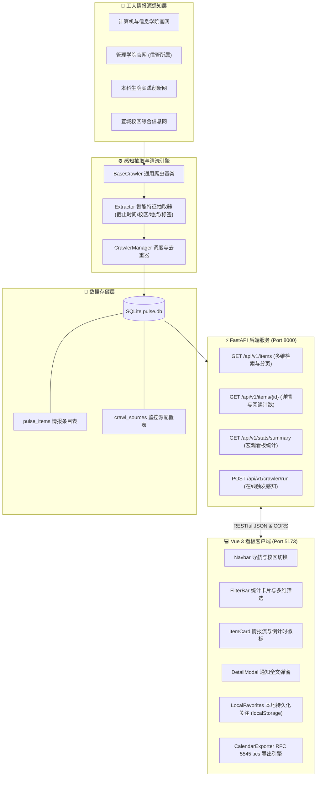
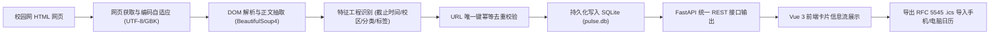

# 📡 HFUT-PerceptPulse (合工大校园学术与竞赛情报感知系统)

[](https://github.com/ayngm54188/hfut-perceptpulse/actions/workflows/ci.yml)
[](https://fastapi.tiangolo.com)
[](https://vuejs.org)
[](https://vitejs.dev)
[](https://www.sqlite.org)
[](LICENSE)

> **HFUT-PerceptPulse** 是由合肥工业大学大一计算机与信管专业同学自主研发的校园学术活动与学科竞赛全栈情报感知系统。  
> 系统面向合肥工业大学**翡翠湖校区、屯溪路校区与宣城校区**，自动化抓取各学院与职能部门最新公告，执行智能特征抽取、到期倒计时预警、本地个性化关注，并支持一键导出标准系统日历日程（.ics）。

---

## 🏛️ 系统架构设计 (System Architecture)

系统采用前后端解耦的现代化单体分层架构，兼顾轻量化部署与工程可维护性：



---

## 🔄 感知层数据流向图 (Data Pipeline Flow)

从校园网原始 HTML 到终端用户日历提醒的全链路数据流：



---

## ✨ 核心特色功能

1. **跨校区多维情报感知**：
   - 自动识别翡翠湖校区、屯溪路校区与宣城校区专属活动，支持全校区与单校区一键切换。
   - 覆盖学术讲座（斛兵大讲堂、学术沙龙）、学科竞赛（蓝桥杯、计算机设计大赛、挑战杯）与双创通知。
2. **动态到期倒计时引擎**：
   - $\le 3$ 天：呈现 **🔥 红色脉冲警示徽章**（如 `距截止 2 天 4 时`）。
   - $4 \sim 7$ 天：呈现 **⚡ 橙色预警**。
   - 历史事项：自动标记为已截止，避免无效关注。
3. **⭐ 我的关注（本地持久化）**：
   - 卡片设有五角星收藏按钮（★/☆），基于 `localStorage` 本地保存，无需登录即开即用。
   - 顶部筛选栏集成 **“⭐ 我的关注”** 专属 Tab 及实时收藏数量徽标。
4. **📅 一键加入系统日历 (.ics 导出)**：
   - 动态生成符合国际 **RFC 5545** 规范的 `.ics` 文件。
   - 内置**提前 1 天日常提醒**与**提前 2 小时紧急提醒**两道闹钟，支持导入 iOS、Mac、Windows Outlook 及安卓日历。
5. **每日定时情报简报**：
   - 脚本 `backend/scripts/automation_runner.py` 自动扫描最新动态，并输出每日 Markdown 决策简报于 `backend/data/reports/`。
6. **自动化 CI/CD 质量防护**：
   - GitHub Actions 自动化执行前后端双流水线校验（Python 依赖测试、数据入库测试、简报生成测试与 Vue 3 构建编译）。

---

## 🚀 快速启动与本地运行指南

### 1. 环境准备
- **Python**：>= 3.10（本项目开发环境为 Python 3.14）
- **Node.js**：>= 18.0（本项目开发环境为 Node.js 20+ / 24）

---

### 2. 后端服务启动 (FastAPI)

```powershell
# 1. 进入后端目录
cd backend

# 2. 激活 Python 虚拟环境 (Windows PowerShell)
.\.venv\Scripts\Activate.ps1

# 3. 安装依赖 (初次运行需执行)
pip install -r requirements.txt

# 4. 初始化数据库与工大专属种子数据 (初次运行需执行)
python seed_data.py

# 5. 启动 FastAPI 本地开发服务器
uvicorn app.main:app --reload --host 127.0.0.1 --port 8000
```
启动后访问接口文档：
- **Swagger 交互式 API 文档**：http://127.0.0.1:8000/docs
- **健康检查接口**：http://127.0.0.1:8000/

---

### 3. 前端应用启动 (Vue 3)

```powershell
# 1. 进入前端目录
cd frontend

# 2. 安装 npm 依赖 (初次运行需执行)
npm install

# 3. 启动 Vite 开发服务器 (默认运行在 5173 端口)
npm run dev
```
打开浏览器访问 👉 **http://localhost:5173**，即可开始体验情报看板！

---

### 4. 独立脚本运行

- **手动触发全网感知爬虫**：
  ```powershell
  cd backend
  python run_crawler.py
  ```
- **生成每日情报 Markdown 简报**：
  ```powershell
  cd backend
  python scripts/automation_runner.py
  ```
- **执行自动化单元测试**：
  ```powershell
  cd backend
  python tests/test_api.py
  ```

---

## 📁 工程目录概览

```text
hfut-perceptpulse/
├── .github/
│   └── workflows/ci.yml         # GitHub Actions 自动化 CI 配置文件
├── .agents/
│   └── rules.md                 # 合工大信管创新班工程规约与注释规范
├── backend/                     # 后端工程 (FastAPI + SQLAlchemy + SQLite)
│   ├── app/
│   │   ├── api/v1/              # RESTful API 路由 (items, stats, crawler)
│   │   ├── core/                # 数据库连接与系统配置
│   │   ├── models/              # SQLAlchemy ORM 数据模型
│   │   ├── schemas/             # Pydantic 严格校验模型
│   │   ├── services/crawlers/   # 校园网感知爬虫模块 (CI院, 管院)
│   │   └── utils/               # 智能特征提取器 (extractor.py)
│   ├── data/                    # 本地 SQLite 数据与每日简报
│   │   ├── pulse.db             # 数据库文件 (自动创建并忽略)
│   │   └── reports/             # 每日生成的 Markdown 简报
│   ├── scripts/
│   │   └── automation_runner.py # 每日定时感知与简报自动化生成器
│   ├── tests/
│   │   └── test_api.py          # 后端健全性测试套件
│   ├── seed_data.py             # 种子数据初始化脚本
│   └── requirements.txt         # 后端 Python 依赖清单
├── frontend/                    # 前端工程 (Vue 3 + Vite + Element Plus)
│   ├── src/
│   │   ├── api/                 # Axios 统一网络请求封装
│   │   ├── components/          # 核心看板组件 (Navbar, FilterBar, ItemCard, DetailModal)
│   │   ├── utils/               # 日历生成器 (calendar.js) 与关注管理 (storage.js)
│   │   ├── App.vue              # 主页面与情报看板布局
│   │   └── main.js              # Vue 应用装配入口
│   ├── package.json             # 前端依赖配置
│   └── vite.config.js           # Vite 配置与反向代理设置
└── README.md                    # 本说明文档
```

---

## 📜 工程规约

本项目严格遵循合工大信管创新班工程标准，包含统一 API 响应格式、Pydantic 严格校验、SQLite CRUD 分层规范以及中文特征抽取注释规范。详情请查阅 [`.agents/rules.md`](.agents/rules.md)。
